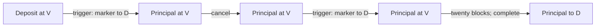

# Purrfect Vault with OP_CAT transaction emulation

This Sapio example implements Purrfect Vault's trigger, cancellation and delayed
withdrawal flow. Its public contract uses one shared vault address, a destination
chosen when triggering, a separately funded 546-satoshi destination output, and
a native twenty-block withdrawal delay.

```sh
cargo run --locked -p sapio_integration_tests --example purrfect_vault
```

The executable uses disposable keys and synthetic coins, compiles each requested
transition, binds its inputs, runs the WASM oracle and completes the signed
transaction. It runs offline. The [Core driver](../contrib/check_purrfect_vault.py)
below funds the same flow on an isolated regtest node.

The reference is Taproot Wizards' MIT-licensed
[purrfect_vault at commit 9e41e4d](https://github.com/taproot-wizards/purrfect_vault/tree/9e41e4dc0a7dc5b6267d117eb8b60cbf594e02ff),
with its three predicates in
[`src/vault/script.rs`](https://github.com/taproot-wizards/purrfect_vault/blob/9e41e4dc0a7dc5b6267d117eb8b60cbf594e02ff/src/vault/script.rs).
That revision requires the same vault owner's signature for every operation.
Its README predates that signature requirement; the executable source is the
reference for authorization.

## One address, three spending paths

Let `V` be the vault script, `A` its principal, and `D` the destination script.
Every transaction has input zero for the vault and input one for a fee sponsor.

| Operation | Outputs | Additional requirement |
| --- | --- | --- |
| Trigger | `A` to `V`, then 546 sats to `D` | Sponsor funds the marker and miner fee |
| Cancel | `A` to `V` | No withdrawal delay |
| Complete | `A` to the previous trigger's `D` | Spend that trigger's output zero; CSV of twenty blocks |

Each path also requires the owner's native Taproot signature and a signature
from its emulated predicate. The owner has no unconditional key-path spend.
The destination marker contains `D` directly in a separate ordinary output;
completion pays the entire principal to the same script. Spending that small
marker does not invalidate completion.



Deposit, triggered and cancelled outputs have the same script and amount.
There is no on-chain state field. A trigger may spend an already triggered
output, selecting another destination and starting a new delay. Cancellation
may spend any vault output. Completion authenticates the immediate parent
transaction's marker; it cannot withdraw through a cancelled parent's
single-output shape.

The proof authenticates the parent's transaction bytes and output shape,
rather than proving which historical spending branch created it. A direct
deposit with the same vault output and destination-marker shape also qualifies
for completion after its own delay.

The same key authorizes trigger, cancel and complete, following the pinned
upstream revision. This model has no separate cold recovery key. Cancellation
returns to the original key's vault rather than rotating keys or providing an
uncompromised recovery destination. Monitoring, cancellation races and key
management remain the wallet operator's responsibility.

## Contract and evidence

[`PurrfectVault`](../sapio-contrib/src/contracts/purrfect_vault.rs) contains only
public terms: the owner key, oracle public derivation root and a local maximum
sponsor fee. Its address does not depend on the deposit amount or selected
destination. `compile(context)` without effects yields the three spending
policies; requesting an action adds its proposed transaction without changing
that address.

The ordinary Sapio action methods are:

- `trigger(context, destination_script)` proposes both outputs.
- `cancel(context)` preserves the principal without a marker.
- `complete(context, previous_trigger)` derives the payout from the supplied
  parent transaction and sets the native sequence delay.

The generated typed action handles encode those requests. The separate
[runner](../integration_tests/src/purrfect_vault_example.rs) chooses disposable
keys and a compilation context, binds actual coins, requests the oracle
signature, signs the owner and sponsor slots, and completes the witness through
Sapio's shared spend APIs.

Trigger and cancel need no auxiliary evidence. Complete supplies
`complete_evidence(previous_trigger)`: the parent's consensus serialization
without any input witnesses or SegWit marker/flag. The
[evaluator](../evaluators/purrfect-vault/src/lib.rs) parses the complete bounded
preimage, hashes it twice, and checks the resulting transaction ID and output
index against the authenticated current input. It checks the previous
principal, vault script, 546-satoshi marker and exact payout script. Supplying
an unrelated transaction, another output index, or a forged destination cannot
authorize withdrawal.

The destination is arbitrary Script bytes within the supported size bound,
matching upstream's transaction predicate. The example runner chooses a
standard address so its transactions also satisfy Core's relay policy.

## Emulation boundary and supported profile

Upstream uses OP_CAT to construct BIP341 signature commitments and a generator
point signature, allowing Script to inspect authenticated transaction fields.
For completion it also reconstructs the prior transaction ID with OP_CAT and
OP_HASH256. Sapio expresses those transaction conditions as a pinned WASM-v2
program over the oracle's authenticated transaction view.

This implementation does not emit or execute native OP_CAT Script. It works
with unmodified Bitcoin Core through ordinary oracle-derived Taproot signing
keys. The oracle must evaluate honestly and remain available. An owner and a
dishonest oracle can bypass the emulated transaction conditions together;
an unavailable oracle prevents spending. Core independently verifies native
owner, oracle and sponsor signatures, Taproot proofs and CSV. The evaluator
also checks the transaction's CSV fields before issuing an oracle signature.

The example uses one selected vault at input zero and one native witness-v0
sponsor at input one. Restricting the sponsor to P2WPKH or P2WSH excludes another
Taproot covenant input whose principal could otherwise be counted twice. Both
inputs have empty scriptSigs. Completion accepts exactly two parent inputs with
empty scriptSigs, canonical CompactSize encodings, exactly two parent outputs,
no trailing data, and at most 520 bytes of stripped parent serialization. That
bound preserves the upstream OP_CAT stack-element limit. The trigger predicate separately
bounds its concatenated outputs to 520 bytes. Sapio's trigger proposal applies
the stricter complete-parent bound as well, rejecting a destination whose
trigger could not later complete. Annexes are excluded.

These are explicit restrictions on the upstream demonstration's broader
witness flexibility. This model does not reproduce its signature grinding or
80-byte witness chunk transport: the oracle receives the stripped transaction
as off-chain evidence. It keeps the required transaction commitments and
native authorization and delay guards. It does not add partial withdrawals,
batching or principal-funded fees.

## Sponsor accounting

The principal is preserved exactly on every operation. The sponsor contributes
the marker on trigger; all remaining sponsor value becomes the miner fee.
Cancel and complete consume the entire sponsor value as fees. There is no
sponsor change output. The maximum sponsor fee is retained local Sapio funding
policy, independent of the evaluator's covenant conditions.

The deterministic fixture deposits 100,000 sats and uses four independent
2,000-satoshi P2WPKH sponsor coins. Each trigger pays 546 sats to its marker
and 1,454 sats in miner fees. Cancel and complete each pay 2,000 sats in fees.
The second trigger selects a different destination. Both markers remain at
their selected destinations, in addition to the final 100,000-satoshi
withdrawal. Real callers must choose appropriate fees and
spendable destination scripts.

## Executable checks

```sh
cargo test --locked -p sapio-contrib purrfect_vault
cargo test --locked -p sapio_integration_tests --test purrfect_vault
cargo test --locked --manifest-path evaluators/Cargo.toml \
  -p sapio-purrfect-vault-evaluator
bash evaluators/build.sh --check
cargo build --locked -p sapio_integration_tests --example purrfect_vault_vectors
python3 contrib/check_purrfect_vault.py /path/to/bitcoind /path/to/bitcoin-cli \
  target/debug/examples/purrfect_vault_vectors
```

The node check creates its own temporary regtest node and wallet. It funds the
vault and sponsors, confirms a trigger and cancellation, then confirms another
trigger. Completion fails immediately and at tip height `H + 18`, where `H`
is that trigger's confirmation height. At `H + 19`, Core admits the completion
for the next block, and it confirms at `H + 20`. The driver checks the exact
principal, marker destinations, fees and output linkage, and rejects a mutated
signed completion and one missing the owner signature.

The WASM and Rust tests exercise the transaction predicates and evidence
validation; Core checks the final witnesses and native timelock boundary. This
is an executable research example, not an audited custody wallet or deployment
of native OP_CAT.
